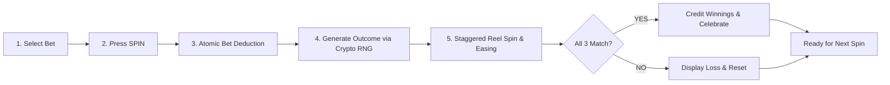

# 🎰 Classic 3-Reel Slot Machine Game

<div align="center">


**A production-ready, modular 2D slot machine game featuring decoupled cryptographic RNG, atomic integer wallet accounting, and mechanical reel easing.**

[🎮 Play Web Demo](#-quick-run-commands) • [📐 Architecture](#-system-architecture) • [🧪 Unit Tests](#-automated-testing-2424-passed) • [📜 Payout Table](#-payout-table)

</div>

---

## 📌 At a Glance

| Feature | Implementation | Benefit |
|---|---|---|
| **Reel Physics** | Infinite recycling loop + cubic bounce ease | Zero runtime allocations (`GC.Alloc`), authentic arcade feel |
| **Fair RNG** | `RNGCryptoServiceProvider` + rejection sampling | Completely eliminates modulo bias; pure mathematical fairness |
| **Credit Wallet** | Integer arithmetic (`checked` overflow safety) | Eliminates floating-point currency drift & duplicate payouts |
| **Separation** | Outcome generated **before** animation starts | Client-side visual timing cannot manipulate or predict results |
| **Audio & UX** | Procedural mechanical clicks, spin loops & chimes | Immersive casino soundscape with persistent mute toggling |

---

## 💎 Payout Table

> **Winning Rule**: A payout is awarded **strictly when all 3 reels match the identical symbol** across the center payline. Any mixed combination is a loss.

| Symbol | Name | Multiplier | Payout (Bet: 10) | Payout (Bet: 100) |
|:---:|:---:|:---:|:---:|:---:|
|  | **Lucky Seven** | **25x** *(Jackpot)* | `250` | `2,500` |
|  | **Triple Bar** | **10x** | `100` | `1,000` |
|  | **Liberty Bell** | **5x** | `50` | `500` |
|  | **Twin Cherries** | **3x** | `30` | `300` |

$$\text{Payout} = \text{Current Bet} \times \text{Multiplier}$$

---

## 🕹️ Gameplay Flow



1. **Adjust Bet**: Step through bet options (`10`, `25`, `50`, `100`) with `◀` and `▶`.
2. **Hit Spin**: Bet is deducted, reels accelerate smoothly into a vertical blur.
3. **Staggered Stop**: Reel 1 stops at `1.2s`, Reel 2 at `1.55s`, Reel 3 at `1.9s` with a mechanical rebound.
4. **Win / Loss**: If 3 symbols match, winnings are credited and the balance counter rolls up with celebration SFX.
5. **Auto-Spin**: Toggle hands-free spins; automatically pauses if credits run out.

---

## 📐 System Architecture

Strict adherence to **SOLID principles** ensures logic and graphics remain completely independent.

```
                              ┌─────────────────────┐
                              │   SlotGameManager   │  (State Machine Coordinator)
                              └──────────┬──────────┘
             ┌───────────────────────────┼───────────────────────────┐
             ▼                           ▼                           ▼
     ┌───────────────┐          ┌─────────────────┐       ┌────────────────────┐
     │  SlotWallet   │          │ IRandomProvider │       │ SlotReelController │
     │ (Integer math)│          └────────┬────────┘       │  (Animation Easing)│
     └───────┬───────┘                   │                └────────────────────┘
             │                  ┌────────▼─────────────┐
             │                  │ SlotOutcomeGenerator │
             │                  └────────┬─────────────┘
             ▼                           │
 ┌───────────────────────┐               │
 │ SlotPayoutCalculator  │◄──────────────┘
 └───────────────────────┘
             ▲
             │
 ┌───────────┴───────────┐
 │   SlotWinEvaluator    │  (Strict 3-Match Rule)
 └───────────────────────┘
```

### Core Classes

- **`SlotGameManager`** — Controls game lifecycle (`Ready`, `Spinning`, `Evaluating`, `ShowingResult`, `InsufficientBalance`).
- **`SlotWallet`** — Thread-safe integer credit balance; guarantees zero negative balances or duplicate deductions.
- **`SlotReelController`** — Manages continuous vertical motion, infinite view recycling, and overshoot landing easing.
- **`CryptoRandomProvider`** — Cryptographically secure, rejection-sampled unbiased RNG (`System.Security.Cryptography`).
- **`DeterministicRandomProvider`** — Seeded mock RNG for deterministic unit tests and replay verification.
- **`SlotOutcomeGenerator`** — Produces target outcomes independently before visual reel animations start.
- **`SlotWinEvaluator`** — Evaluates combination results; enforces exact 3-match win criteria.
- **`SlotPayoutCalculator`** — Computes reward credits based on wager and configurable paytable.
- **`SlotUIController`** — Drives HUD displays, balance counting animations, win banners, and modal dialogs.
- **`SlotAudioManager`** — Plays mechanical reel loops, clicks, stop thuds, chimes, and fanfare with persistent mute.

---

## 🚀 Quick Run Commands

### 1. Instant Web Play (Local Server)
Run from the repository root:
```powershell
python -m http.server 3000 --bind 127.0.0.1
```
👉 Open **[http://localhost:3000/WebPreview/index.html](http://localhost:3000/WebPreview/index.html)**

### 2. Run Automated Unit Tests (24/24 Passing)
```powershell
powershell -ExecutionPolicy Bypass -File .\Tools\run_tests.ps1
```

### 3. Open in Unity Editor
1. Open **Unity Hub** ➔ Click **Add** ➔ Select this repository folder.
2. Recommended Version: **Unity 2021.3 LTS / 2022.3 LTS / Unity 6**.
3. Open `Assets/Scenes/MainScene.unity` and click **Play** ▶️.
4. *(Optional Rebuild)*: Click top menu: **Tools** ➔ **Slot Game** ➔ **Rebuild Main Scene**.

### 4. WebGL Export
- **Inside Unity Editor**: Click **Build** ➔ **Build WebGL** (exports to `Build/WebGL/`).
- **Via Batchmode Command Line**:
```powershell
& "<path-to-unity>\Unity.exe" -quit -batchmode -projectPath . -executeMethod SlotGame.Editor.SlotGameBuildScript.BuildWebGL
```

### 5. Deploy to AWS (S3 & CloudFront / AWS Amplify)
```powershell
# Automated 1-Click AWS S3 Deployment
.\Tools\deploy_aws_s3.ps1 -BucketName "unity-slot-machine-<unique-id>" -Region "us-east-1"
```
*Or connect your GitHub repository to **AWS Amplify** for automatic CI/CD deployment on every `git push`.*

---

## 🧪 Automated Testing (24/24 Passed)

<div align="center">

| Test Suite | Total Tests | Status | Verification Target |
|---|:---:|:---:|---|
| **Wallet Tests** | 8 | ✅ **PASS** | Starting balance, atomic deduction, insufficient funds block, no negative balances |
| **Win Evaluator Tests** | 7 | ✅ **PASS** | 3-match wins on all symbols, partial matches loss, all-different loss, null safety |
| **Payout Calculator Tests** | 6 | ✅ **PASS** | 25x, 10x, 5x, 3x multipliers, zero/negative bet rejection, unmapped ID safety |
| **RNG Tests** | 3 | ✅ **PASS** | Rejection sampling range bounds $[0, 4)$, seeded repeatability, outcome bounds |

</div>

---

## 📁 Repository Structure

```
unity-slot-game/
├── Assets/
│   ├── Art/                # Sliced original arcade cabinet frames, buttons & symbols
│   ├── Scenes/             # MainScene.unity (Connected 2D UI Canvas scene)
│   ├── ScriptableObjects/  # DefaultSlotGameConfig.asset, Symbol_*.asset
│   ├── Scripts/
│   │   ├── Audio/          # SlotAudioManager.cs
│   │   ├── Core/           # SlotGameManager, SlotWallet, Config, State Machine
│   │   ├── Editor/         # Scene auto-builder & WebGL batch build script
│   │   ├── Payouts/        # SlotWinEvaluator, SlotPayoutCalculator
│   │   ├── Reels/          # SlotReelController (Motion & Easing)
│   │   ├── RNG/            # CryptoRandomProvider, DeterministicRandomProvider
│   │   └── UI/             # SlotUIController
│   ├── Sounds/             # Procedural mechanical clicks, spin loops & chimes
│   └── Tests/EditMode/     # NUnit automated unit test suites
├── Packages/               # Package manifest (UGUI, 2D Sprite, Test Framework)
├── ProjectSettings/        # EditorBuildSettings, PlayerSettings
├── Tools/
│   ├── run_tests.ps1       # Standalone test runner script
│   └── SlotGameCore.dll    # Compiled testable C# assembly
└── WebPreview/
    └── index.html          # Interactive companion playable simulation
```

---

## 👨‍💻 Author

<div align="center">

### **Priyanshu Singh**
*Unity Game Developer & Software Engineer*

[](https://github.com/PriyanshuSingh10114)
[](https://github.com/PriyanshuSingh10114)

</div>

---

## 📄 License

This project is licensed under the [MIT License](LICENSE) — free for educational and commercial review.
